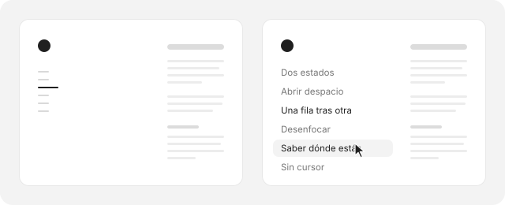

El índice de la izquierda está inspirado en el sitio de Noé Chagué. Me gustó porque resuelve un problema viejo de los textos largos. Un índice siempre visible distrae, y uno escondido detrás de un botón casi nunca se usa.

La salida es dejarlo a la vista, pero reducido a lo mínimo. Estas notas recogen cómo funciona, para no olvidarlo la próxima vez que lo necesite.

## Dos estados

Mientras lees, cada sección es una raya corta y gris. La de la sección en la que estás es casi el doble de larga y oscura, así que el índice funciona también como una barra de progreso que no ocupa lugar.

Cuando el cursor entra en esa columna, las rayas se convierten en los títulos. Al salir vuelven a ser rayas.

## Abrir despacio, cerrar rápido

Las dos transiciones no duran lo mismo. Abrir tarda cerca de medio segundo, porque en ese momento el ojo está buscando algo y conviene acompañarlo. Cerrar tarda la mitad, porque cuando el cursor se va la persona ya volvió al texto y nada debería quedarse moviéndose al costado.

| | Abrir | Cerrar |
| --- | ---: | ---: |
| Opacidad | 0,4 s | 0,15 s |
| Desenfoque y desplazamiento | 0,55 s | 0,3 s |
| Altura de cada fila | 0,3 s | 0,3 s |

Las dos usan la misma curva, `cubic-bezier(.16, 1, .3, 1)`, que arranca rápido y frena muy suave.

## Una fila tras otra

Al abrirse, cada título llega 50 milisegundos después del anterior. Ese escalonado hace que se lea como una lista que se despliega y no como un bloque que aparece de golpe.

A partir de la quinta fila todas llegan juntas. En un índice largo, esperar a que se abra la última sería más molesto que bonito. Al cerrarse no hay escalonado y todo se va a la vez.

## Desenfocar en vez de mover

Los títulos no entran deslizándose desde lejos. Se mueven apenas 4 píxeles y pasan de desenfocados a nítidos. El desenfoque hace el trabajo que normalmente haría el movimiento, con mucho menos ruido.

Las rayas, en cambio, se encogen hacia la izquierda hasta quedar en un 15 % de su ancho mientras se desvanecen, como si el título las empujara.

## Saber dónde estás

Con cada scroll se busca el último subtítulo que ya cruzó una línea imaginaria a 81 píxeles del borde de arriba. Esa es la sección actual.

Hay un caso especial. Las secciones cortas del final nunca llegan a esa línea, porque la página se termina antes. Por eso, durante la última pantalla de recorrido, la línea baja poco a poco hasta cerca del borde de abajo, y al llegar al final queda marcada la última sección.

Además, después de un clic en el índice se respeta la sección elegida hasta que termina el desplazamiento, aunque la página no alcance a subirla hasta arriba.

## Sin cursor

- Al recorrer el índice con la tecla Tab se abre igual que con el cursor.
- En pantallas de menos de 1280 píxeles no hay índice. No queda espacio al costado y el texto se lee mejor solo.
- Si el sistema pide menos movimiento, las transiciones pasan a ser instantáneas.
